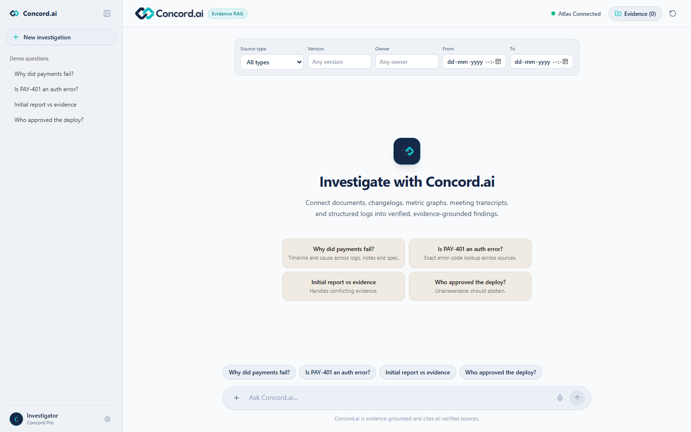
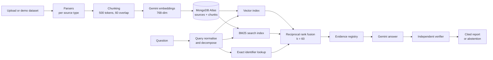

<div align="center">


### Evidence-grounded incident investigation on MongoDB Atlas Vector Search

Ask a question about an engineering incident. Concord.ai searches every document, changelog,
metric graph, meeting transcript and log you gave it, and answers only with claims it can cite.




</div>

## Contents

- [Why Concord.ai](#why-concordai)
- [Features](#features)
- [Architecture](#architecture)
- [Tech stack](#tech-stack)
- [Demo dataset](#demo-dataset)
- [Quick start](#quick-start)
- [Configuration](#configuration)
- [API](#api)
- [Evaluation](#evaluation)
- [Tests](#tests)
- [Project structure](#project-structure)
- [Roadmap](#roadmap)
- [Contributing](#contributing)
- [Team](#team)
- [Limitations](#limitations)

## Why Concord.ai

During an incident, the evidence is spread across a runbook PDF, a release changelog, a metric
screenshot, a meeting transcript and thousands of log lines. A general chatbot will happily
guess. Concord.ai does not: every claim in an answer points at the exact page, heading, cue,
row or log line it came from, a second model checks each claim against that text, and when
nothing verifies, Concord.ai says it does not know.

## Features

- **Multi-source ingestion**: PDF, DOCX, Markdown, HTML, TXT, VTT transcripts, JSON and CSV logs,
  and images, each parsed with its structural locator (page, heading, cue, row, event).
- **Hybrid retrieval**: Atlas Vector Search (semantic), Atlas Search BM25 (keywords) and an
  exact-identifier lookup (error codes, versions, ticket IDs), fused with reciprocal rank fusion.
- **Grounded answers**: Gemini answers only from a registry of retrieved chunks, and an
  independent Gemini verifier checks every cited claim.
- **Abstention**: an unanswerable question gets a clear "not enough evidence", never a guess.
- **Metadata filters**: incident, source type, version, owner and time range, applied inside
  the search, not after it.
- **Projects**: each incident is its own project; sources are stored once and reused.
- **Built-in benchmark**: Recall@k, MRR, nDCG, precision, hit rate and faithfulness on a
  labelled question set.

## Architecture



| Layer | Location | Responsibility |
| :--- | :--- | :--- |
| Ingestion | `backend/app/ingestion/` | Parse each source type, keep locators, split oversized units |
| Services | `backend/app/services/` | Gemini embeddings, generation, verification; idempotent ingestion |
| Core | `backend/app/core/` | MongoDB connection, operational indexes, search-index readiness |
| Retrieval | `backend/app/retrieval/` | Vector search, BM25, identifier lookup, RRF |
| Reasoning | `backend/app/reasoning/` | Query transform, evidence registry, claims, verification, abstention |
| API | `backend/app/api/` | FastAPI routes for ingest, investigate and eval |
| UI | `frontend/src/` | Next.js investigation console with citations and filters |

Every chunk is stored with its text, embedding, content hash, source metadata and locator in one
document, so a single Atlas query can filter and rank it. Chunk IDs are deterministic, which
makes re-ingestion repeat-safe. The browser only talks to FastAPI; the MongoDB URI and Gemini key
never leave the backend.

## Tech stack

| Area | Choice |
| :--- | :--- |
| Backend | Python 3.12, FastAPI, Pydantic Settings |
| Database | MongoDB Atlas: Vector Search (cosine, 768-dim) and Atlas Search (BM25) |
| Models | Gemini 2.5 Flash (answer and verifier), `gemini-embedding-001` |
| Parsing | PyMuPDF, python-docx, BeautifulSoup, Pillow |
| Chunking | LangChain recursive splitter with tiktoken |
| Frontend | Next.js 16, React 19, Tailwind CSS 4 |

## Demo dataset

`backend/synthetic_data` holds a fictional payments incident, **INC-2026-1042**: 20 sources
across documents, changelogs, metric graphs, transcripts and logs, plus 20 labelled evaluation
questions. The four demo questions on the home screen each test something different:

| Question | What it shows |
| :--- | :--- |
| Why did payments fail? | Timeline and cause across logs, notes and spec |
| Is PAY-401 an auth error? | Exact error-code lookup |
| Initial report vs evidence | Conflicting sources handled honestly |
| Who approved the deploy? | Unanswerable: Concord.ai abstains |

## Quick start

**Needs:** Python 3.12, Node.js 20+, Docker, and a free [Gemini API key](https://aistudio.google.com/apikey).

**1. Start a local Atlas** (Vector Search and Atlas Search included):

```bash
docker run -d --name concord-mongo -p 27017:27017 mongodb/mongodb-atlas-local:latest
```

**2. Backend:**

```bash
cd backend
python -m venv .venv
.venv\Scripts\activate            # macOS/Linux: source .venv/bin/activate
pip install -r requirements.txt
copy .env.example .env            # macOS/Linux: cp .env.example .env
```

In `backend/.env` set `MONGODB_URI=mongodb://localhost:27017/?directConnection=true` and your
`GEMINI_API_KEY`. Then create both search indexes and start the API:

```bash
python -m scripts.manage_vector_index --create
uvicorn app.main:app --reload --port 8000
```

**3. Load the demo incident:**

```bash
curl -X POST "http://localhost:8000/api/ingest/batch?incident_id=INC-2026-1042"
```

**4. Frontend:**

```bash
cd frontend
npm ci
npm run dev
```

Open http://localhost:3000. API docs live at http://localhost:8000/docs.

> Using Atlas cloud instead? Put your `mongodb+srv://` URI in `.env`; the free tier allows the
> three search indexes this project needs.

## Configuration

All settings live in `backend/.env` (see `backend/.env.example`).

| Variable | Default | Purpose |
| :--- | :--- | :--- |
| `MONGODB_URI` | | Atlas or Atlas Local connection string |
| `MONGODB_DATABASE` | `traceiq_db` | Database name |
| `MONGODB_SOURCE_COLLECTION` | `sources` | One document per source |
| `MONGODB_CHUNK_COLLECTION` | `chunks` | Chunks with embeddings |
| `MONGODB_VECTOR_INDEX` | `traceiq_vector_index` | Vector Search index name |
| `MONGODB_SEARCH_INDEX` | `traceiq_search_index` | BM25 index name |
| `GEMINI_API_KEY` | | Embeddings, answers and verification |
| `LLM_MODEL` | `gemini-2.5-flash` | Answer and verifier model |
| `EMBEDDING_MODEL` | `gemini-embedding-001` | Embedding model |
| `EMBEDDING_DIMENSIONS` | `768` | Must match the vector index |
| `CHUNK_SIZE` / `CHUNK_OVERLAP` | `500` / `60` | Tokens per chunk and overlap |
| `RETRIEVAL_CANDIDATE_LIMIT` | `30` | Candidates per retriever |
| `FINAL_EVIDENCE_LIMIT` | `10` | Chunks passed to the model |
| `MAX_SOURCE_FILE_BYTES` | `26214400` | Upload size limit (25 MB) |
| `SEARCH_INDEX_TIMEOUT_SECONDS` | `90` | Wait for indexes to become queryable |
| `CORS_ORIGINS` | | Comma-separated frontend origins |

Changing the embedding model or dimensions means recreating the vector index and re-embedding
every chunk; vectors from different models must never share an index.

## API

| Method | Route | What it does |
| :--- | :--- | :--- |
| `POST` | `/api/ingest/batch?incident_id=` | Import the demo dataset (repeat-safe) |
| `POST` | `/api/ingest/upload` | Upload one file (`file`, `source_type`, `incident_id`, `owner`) |
| `GET` | `/api/ingest/sources?incident_id=` | List a project's sources |
| `GET` | `/api/ingest/runs/{run_id}` | One ingestion run's summary |
| `POST` | `/api/investigate/` | Ask a question, with optional filters |
| `GET` | `/api/eval/benchmark` | Run the benchmark |
| `GET` | `/health`, `/ready` | Liveness; MongoDB, indexes, Gemini and dataset readiness |

```bash
curl -X POST http://localhost:8000/api/investigate/ \
  -H "Content-Type: application/json" \
  -d '{"query": "Why did payments fail after the 2.4.0 deployment?", "incident_id": "INC-2026-1042"}'
```

## Evaluation

```bash
curl "http://localhost:8000/api/eval/benchmark?top_k=10"                        # retrieval only
curl "http://localhost:8000/api/eval/benchmark?top_k=10&generate_answers=true"  # + answers
```

Retrieval returns `mean_recall_at_k`, `mean_reciprocal_rank`, `hit_rate`, `mean_precision_at_k`,
`mean_ndcg_at_k` and `pass_rate`. With `generate_answers=true` it also checks citation validity,
abstention and `mean_faithfulness`. The question set covers exact identifiers, semantic,
multi-source, conflicting-source and unanswerable cases.

## Tests

```bash
cd backend
python -m pytest -q
python scripts/validate_synthetic_data.py synthetic_data

cd ../frontend
npm run lint
npm run build
```

Backend tests run offline on deterministic fixtures; they make no MongoDB or Gemini calls.

## Project structure

```text
backend/
  app/
    api/            FastAPI routes: ingest, investigate, eval
    core/           MongoDB connection and index readiness
    ingestion/      parsers and chunking
    retrieval/      vector search, hybrid search, RRF
    reasoning/      query transform and investigator
    services/       Gemini, embeddings, ingestion service
  scripts/          search-index setup and dataset validator
  synthetic_data/   demo incident INC-2026-1042
  tests/            offline test suite
frontend/
  src/app/          Next.js pages
  src/components/   chat, citations, upload drawer
  src/lib/          shared types and demo questions
docs/               product requirements (TraceIQ_PRD.pdf) and images
learn_documents/    RAG primer and codebase tour
```

## Roadmap

Open work is tracked as GitHub issues in the
[Hackathon submission](https://github.com/CodingTJ1507/RAG_Transfinitte/milestones) milestone:

- **Ingestion quality**: HTML and TXT sections, PDF sections, owners, image understanding,
  real dates, source authority (#14 to #19)
- **Search insight**: explain plans and `numCandidates` tuning (#20), skip unchanged sources (#22)
- **Reliability**: bounded Gemini retries, clear rate-limit messages, verifier fallback (#21)
- **Storage and UI**: originals in GridFS (#23), file list (#24), incidents (#26),
  benchmark page (#27)
- **Release**: final evaluation, deployment and demo (#28 to #31)

## Contributing

1. Pick an issue assigned to you and branch from fresh `main` (one branch per issue).
2. Follow [`AGENTS.md`](AGENTS.md) and the product plan in [`docs/TraceIQ_PRD.pdf`](docs/TraceIQ_PRD.pdf).
3. Add tests in your own test file and show them failing before your change.
4. Open a PR using the template, with `Closes #N` or `Part of #N` and real test output.
5. Never commit `.env`, keys or `backend/uploads/`.

## Limitations

- Images are indexed by their manifest description until image understanding lands (#17).
- No authentication yet; run it locally or behind your own gateway.
- Rank fusion runs in Python, so it works on any Atlas tier without `$rankFusion`.
- The verifier is a model, not a proof; measure it against human labels before trusting it fully.
